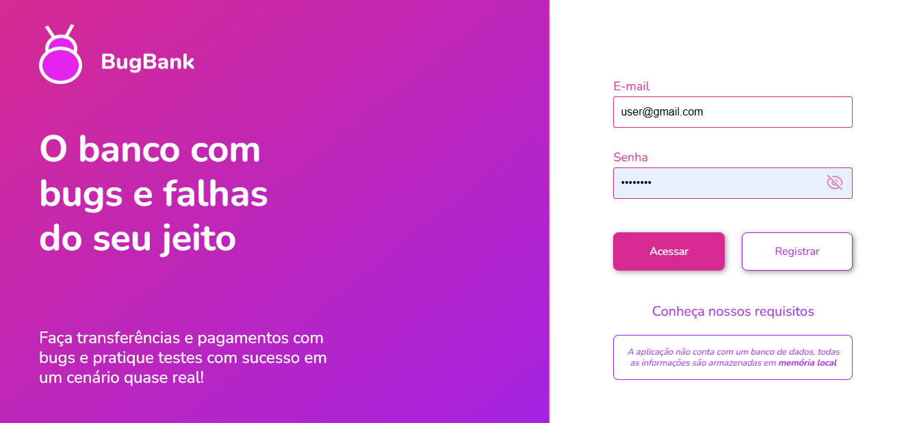

# Testes automatizados do BugBank

Projeto de testes automatizados para validar os principais fluxos da aplicação
[BugBank](https://bugbank.netlify.app/), uma aplicação bancária fictícia
disponibilizada para a prática de testes funcionais.

Os testes foram escritos com Playwright e verificam fluxos de cadastro, login,
transferências, validações de entrada e visibilidade de elementos da interface.

## Objetivos dos testes

- Validar o cadastro de uma nova conta com saldo inicial.
- Confirmar que o usuário consegue realizar login após o cadastro.
- Verificar validações relacionadas a transferências.
- Garantir que dados inválidos não sejam aceitos nos campos de transferência.
- Validar mensagens apresentadas pela aplicação em situações inválidas.
- Confirmar a visibilidade e a interação com elementos importantes da página.
- Executar os cenários em diferentes navegadores para aumentar a cobertura.

## Cenários testados

### Transferências

- Impedir o preenchimento de letras no número da conta.
- Impedir transferência com valor negativo.
- Impedir transferência para a própria conta.
- Validar a tentativa de transferência sem informar a conta de destino.

### Visibilidade e navegação

- Verificar a visibilidade do botão **Acessar**.
- Verificar a visibilidade e o funcionamento do link **Conheça nossos
  requisitos**.
- Verificar a visibilidade do texto informativo da tela de transferência.

### Criação de conta e login

- Criar uma conta com a opção de adicionar saldo ativada.
- Confirmar a mensagem de sucesso do cadastro.
- Realizar login com a conta criada.
- Confirmar a exibição do saldo inicial de **R$ 1.000,00**.

Ao todo, o arquivo `tests/atividade.spec.ts` contém 8 cenários. Como a
configuração executa cada cenário em Chromium, Firefox e WebKit, a suíte
resulta em 24 execuções de teste.

## Tecnologias utilizadas

- **Node.js**: ambiente de execução.
- **TypeScript**: linguagem dos testes.
- **Playwright Test**: automação do navegador, assertions e geração de
  relatórios.
- **Chromium, Firefox e WebKit**: navegadores configurados para a execução.
- **GitHub Actions**: configuração de integração contínua em
  `.github/workflows/playwright.yml`.

## Página utilizada como referência

Os testes utilizam a aplicação BugBank disponível em:

<https://bugbank.netlify.app/>

Captura de tela da página de login utilizada como referência:



## Pré-requisitos

- Node.js instalado.
- npm disponível no terminal.
- Acesso à internet para abrir a aplicação BugBank durante a execução.

## Instalação

Na raiz do projeto, instale as dependências:

```bash
npm install
```

Caso os navegadores do Playwright ainda não estejam instalados, execute:

```bash
npx playwright install
```

## Execução dos testes

Para executar toda a suíte nos três navegadores configurados:

```bash
npx playwright test
```

Para executar os testes em um navegador específico:

```bash
npx playwright test --project=chromium
npx playwright test --project=firefox
npx playwright test --project=webkit
```

Para executar um arquivo específico:

```bash
npx playwright test tests/atividade.spec.ts
```

## Relatório de execução

O projeto utiliza o repórter HTML do Playwright. Após a execução, abra o
relatório com:

```bash
npx playwright show-report
```

Em caso de falha com rastreamento habilitado, o Playwright também pode gerar
arquivos de trace para auxiliar na investigação do cenário.

## Estrutura principal

```text
.
├── image.png
├── playwright.config.ts
├── tests/
│   └── atividade.spec.ts
└── .github/
    └── workflows/
        └── playwright.yml
```
